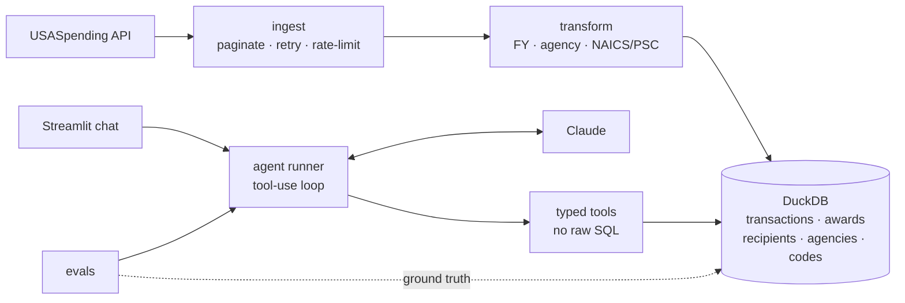

# fedlens-agent

**An AI agent that turns public federal contract spending data into cited, plain-English answers, built like a forward deployed engagement.**

[](https://github.com/tesah-bot-accoint/fedlens-agent/actions/workflows/ci.yml)

[](LICENSE)

> 🎬 **Demo video:** _coming in Phase 6_ · 🌐 **Live demo:** _coming in Phase 6_

> **Status:** Phase 1 of 6 (scoping and architecture). Sections marked _TBD_ are filled in as each phase ships.

---

## The Problem

The **Office of Acquisition Insights** (a fictional federal contracting office) has analysts who spend 30 to 90 minutes answering questions like *"Which vendors received the most DoD IT contract dollars in Oklahoma last fiscal year?"* by hand on USASpending.gov: build a search, export a CSV, pivot it in Excel. Answers are slow, hard to repeat, and two analysts often get different numbers because they made different filter choices (fiscal or calendar year, lifetime award value or obligations in the year). OAI wants an assistant that answers in plain English, **shows its numbers, states its filters, and cites the underlying award records** so every answer can be checked.

Full brief: [docs/engagement-brief.md](docs/engagement-brief.md)

## Discovery & Scoping

**Questions I'd ask stakeholders first** (the full list is in the brief):
- When you say "last year," do you mean the fiscal or the calendar year?
- Do you report **obligations in a period** or **lifetime award value**?
- How do you define "IT": by NAICS, by PSC, or by an internal list?
- Is a location the recipient's address or the place of performance?
- What does a citation need to look like for you to paste the answer into a briefing?

**In scope:** prime contracts (types A to D), DoD / VA / DHS / GSA, FY2024 to FY2026, IT-focused NAICS by default. All of it is configurable in [`config/scope.yaml`](config/scope.yaml).
**Out of scope:** grants and loans, subawards, forecasting, questions about individuals, and **USPS** (it's exempt from the FAR, so USASpending coverage is too thin to trust).

**Success criteria:**

| Metric | Target |
|---|---|
| Correct on answerable questions | ≥ 90% |
| Numeric claims with citations | 100% |
| Clarifies ambiguous asks | ≥ 80% |
| Declines unanswerable questions without inventing numbers | 100% |
| Latency p50 / p95 | < 15s / < 30s |
| Cost per question (median) | < $0.05 |

## Architecture



A batch pipeline copies a scoped slice of USASpending into DuckDB at **transaction grain**, so dollars land in the fiscal year they were obligated ([ADR 002](docs/decisions/002-data-grain.md)). The agent can only answer by calling typed, parameterized tools. It never writes SQL. The UI and the evals share one runner, so what we evaluate is exactly what users see. Details: [docs/architecture.md](docs/architecture.md) · Decisions: [docs/decisions/](docs/decisions/)

## What I Built
_TBD (Phases 2 to 4): pipeline, agent tools, runner, UI._

## Results
_TBD (Phase 5): eval scorecard, latency, cost per query._

## Trust & Safety
_TBD (Phase 3): citations, no model-written SQL, refusal behavior, data limitations._

## Deployment
_TBD (Phase 6): local, Docker, Streamlit Community Cloud / Hugging Face Spaces._

## What I'd Do Next in a Real Engagement
_TBD (Phase 6): auth, FedRAMP considerations, monitoring, feedback loop, scaling to Databricks._

## Quickstart

```bash
git clone https://github.com/tesah-bot-accoint/fedlens-agent && cd fedlens-agent
uv sync
uv run pytest
```

_The data bootstrap and the app arrive in Phases 2 and 4._

---

*All data is public, from [USASpending.gov](https://www.usaspending.gov). The "Office of Acquisition Insights" is fictional. This project contains no employer code, data, or internal references.*
