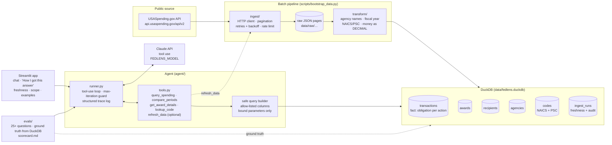

# Architecture

fedlens has three layers: a **batch pipeline** that copies a scoped slice of USASpending into a local DuckDB file, an **agent** that answers questions only by calling a small set of typed, parameterized tools over that file, and a **UI** that shows both the answer and how it was produced.

## Components

### Ingest (`src/fedlens/ingest/`)
A thin, typed client for the endpoints we actually use. These were checked against the official API contracts in [`fedspendingtransparency/usaspending-api`](https://github.com/fedspendingtransparency/usaspending-api/tree/master/usaspending_api/api_contracts/contracts/v2):

| Endpoint | Used for |
|---|---|
| `POST /api/v2/search/spending_by_transaction/` | **Fact rows**: each contract action with `Action Date` and `Transaction Amount` (the obligation), which lets us attribute dollars to the correct fiscal year |
| `POST /api/v2/search/spending_by_award/` | **Award attributes**: NAICS, PSC, place-of-performance state, recipient UEI, description, `generated_internal_id` |
| `GET /api/v2/awards/{generated_unique_award_id}/` | Single-award detail for `get_award_details`, plus the source link |
| `GET /api/v2/references/toptier_agencies/` | Agency lookup (names, abbreviations, toptier codes) |
| `GET /api/v2/references/naics/` and `POST /api/v2/references/filter_tree/psc/` | NAICS and PSC descriptions |

The client handles these concerns:
- **Pagination.** Requests are page-based with `page_metadata.hasNext`. Elasticsearch caps how far you can page into one result set (`ES_*_MAX_RESULT_WINDOW = 50,000` records in the server settings), so the client **splits each fiscal year into monthly windows** and splits further if a window would exceed the cap.
- **Retries.** Exponential backoff with jitter on 429, 5xx, and timeouts (via `tenacity`), and a client-side rate limit (default 2 req/s, configurable).
- **Partial failures.** Each (agency, window) chunk is its own unit of work. Failed chunks are recorded in `ingest_runs` and can be retried without refetching the chunks that succeeded.
- **Audit.** Raw responses are written to `data/raw/` before transform, so any number traces back to the exact API payload.

### Transform (`src/fedlens/transform/`)
Pure functions with no I/O, so they're easy to unit test:
- Federal **fiscal year** from a date (Oct 1 starts the next FY).
- **Agency names** normalized to a canonical toptier name and abbreviation (for example, "DEPT OF DEFENSE" becomes "Department of Defense" / DOD).
- **NAICS/PSC** codes stripped, zero-padded, and split into code and description. NAICS hierarchy prefixes (2-, 3-, 4-, and 6-digit) are kept so filters can match by prefix.
- **Money** parsed from strings into `DECIMAL(18,2)`, never float.
- **Recipient** names trimmed and upper-cased for grouping. Recipients are keyed on UEI where one is present.

### Store (`src/fedlens/store/`)
A single-file DuckDB database (see [ADR 001](decisions/001-duckdb.md)). The grain is one row per contract action (see [ADR 002](decisions/002-data-grain.md)).

| Table | Key | Notes |
|---|---|---|
| `transactions` | `transaction_key` (hash of award id + mod + action date + amount) | `fiscal_year`, `action_date`, `obligation`, FK `award_id` |
| `awards` | `award_id` (`generated_internal_id`) | `piid`, agency/sub-agency, `recipient_key`, `naics`, `psc`, `pop_state`, `description`, `usaspending_url` |
| `recipients` | `recipient_key` (UEI or name hash) | `name`, `uei` |
| `agencies` | `toptier_code` | `name`, `abbreviation` |
| `codes` | (`code_type`, `code`) | NAICS and PSC descriptions |
| `ingest_runs` | `run_id` | scope, start and end times, chunks ok/failed, row counts. This is where "data freshness" comes from. |

Loads are **idempotent**: rows are upserted on their natural keys inside one transaction per chunk, so re-running the bootstrap does not create duplicates.

### Agent (`src/fedlens/agent/`)
- **`tools.py`** defines each tool as a JSON schema (for Claude) plus a Python function. The model never writes SQL. It fills in typed filters, and a **query builder** maps them onto an allow-list of columns and `GROUP BY` options with bound parameters (see ADR 003, Phase 3).
- **`prompts.py`** holds the system prompt: answer only from tool results, cite award IDs and links, state the filters used, ask a clarifying question when a request is ambiguous, format money consistently, and refuse to speculate about individuals.
- **`runner.py`** runs the Claude tool-use loop. It caps iterations (`FEDLENS_MAX_TOOL_ITERATIONS`), records every tool call, its inputs, timing, and token usage into a **trace**, and returns `(answer, trace)`. The UI and the evals use the same runner, so what we evaluate is exactly what users see.

### UI (`src/fedlens/app/streamlit_app.py`)
A chat interface. Each answer has a collapsible **"How I got this answer"** panel that renders the trace (tools, filters, row counts, links). The sidebar shows the data freshness date from `ingest_runs`, the current scope, and example questions.

### Evals (`evals/`)
`questions.yaml` holds 25+ cases across five categories: lookup, aggregation, comparison, ambiguous, and unanswerable. Expected answers are **computed from DuckDB at eval time**, not hard-coded, so evals stay valid after a refresh. `run_evals.py` scores correctness, citation presence, clarification behavior, latency, and token cost, then writes timestamped JSON plus a markdown scorecard to `evals/results/`.

## Request lifecycle

1. The analyst asks, "Top 5 DoD IT vendors in Oklahoma in FY2025?"
2. The runner sends the question, the system prompt, and the tool schemas to Claude.
3. Claude calls `query_spending(agency="Department of Defense", state="OK", fiscal_year=2025, group_by="recipient", top_n=5)`.
4. The query builder produces parameterized SQL over `transactions ⋈ awards`. The result includes totals plus the top award IDs and links for each recipient.
5. Claude writes the answer: a ranked list, money formatted as `$12.3M`, a filter statement, and citations.
6. The UI renders the answer and the trace. The trace is also logged as JSON lines.

## Deployment shape
- **Local:** `uv run` the bootstrap, then `streamlit run`.
- **Docker:** one image. `docker compose up` mounts `./data` so the DuckDB file persists between runs.
- **Hosted demo:** Streamlit Community Cloud or Hugging Face Spaces, with `ANTHROPIC_API_KEY` stored as a platform secret and a prebuilt DuckDB file.
- **Real engagement:** see "What I'd do next" in the README (authorized LLM endpoint, SSO, monitoring, Databricks/Delta).
